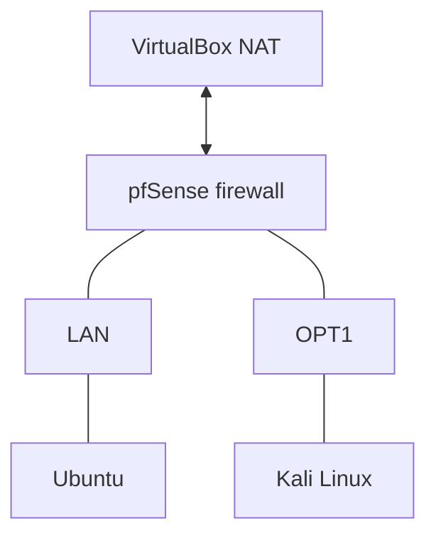

# Day 1 — Network diagram

This is the basic layout of my lab. I have hidden the IP addresses in this public version.

## Adapter setup I used

| VM | Adapter | Network |
|---|---|---|
| pfSense | Adapter 1 | NAT |
| pfSense | Adapter 2 | Internal Network: `int network` |
| pfSense | Adapter 3 | Internal Network: `attacker` |
| Kali | Adapter 1 | Internal Network: `attacker` |

I still need to double-check the adapter mapping if I change the setup. Ubuntu is connected to the LAN side in this layout.

## Tests so far

- Kali to pfSense OPT1: worked after I added a pass rule.
- Kali to Ubuntu: worked.
- Ubuntu to Kali: worked.
- Windows to Kali: not working yet.

The OPT1 rule used during troubleshooting had destination set to `Any`. I need to tighten that rule later instead of leaving it broad.

This diagram is just a simple overview, not proof of the exact wiring. I will add screenshots after capturing them and hiding private details.
