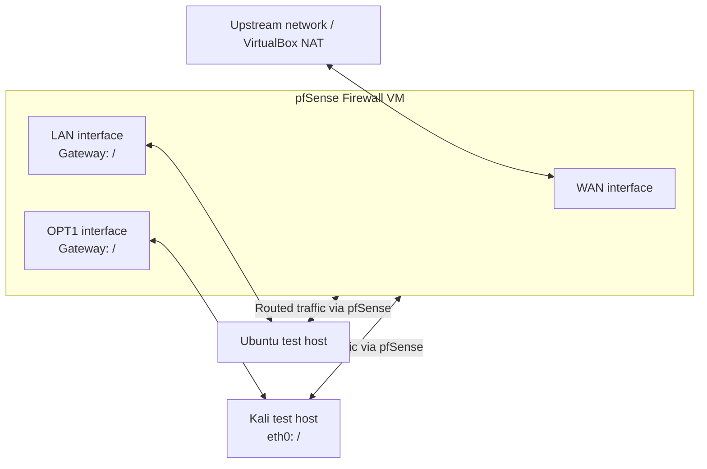

# Day 1 — Network Architecture Diagram

This diagram represents the **logical** pfSense lab topology based on the configuration and tests reported during Day 1. All IP addresses are intentionally replaced with placeholders for this public repository.

## Logical topology

> The diagram is a logical overview, not a literal wiring diagram. Confirm VirtualBox adapter-to-interface mapping in the current VM settings before relying on it. The exact WAN address is intentionally not shown.

## Reported adapter mapping

| Virtual machine | Adapter | VirtualBox network | Intended role |
|---|---|---|---|
| pfSense | Adapter 1 | NAT | WAN / upstream |
| pfSense | Adapter 2 | Internal Network — `int network` | LAN side |
| pfSense | Adapter 3 | Internal Network — `attacker` | OPT1 / Kali side |
| Kali | Adapter 1 | Internal Network — `attacker` | Connects to pfSense OPT1 |
| Ubuntu | Not fully confirmed here | LAN-side network | Internal test host |

## Day 1 connectivity findings

- Kali ↔ pfSense OPT1 ping: successful after adding an OPT1 pass rule.
- Kali ↔ Ubuntu ping: reported successful.
- Ubuntu ↔ Kali ping: reported successful.
- Windows → Kali ping: still pending investigation.

## Security notes

- Replace placeholders only in your private lab notes; do not publish actual public/WAN addresses.
- The initial OPT1 rule used destination **Any** for troubleshooting. Review it and narrow permissions to the minimum required traffic.
- Keep screenshots sanitized: hide IP details, usernames, hostnames, MAC addresses, and unrelated network information before committing them.
- This diagram documents the reported topology; verify it against the current lab before presenting it as final evidence.
